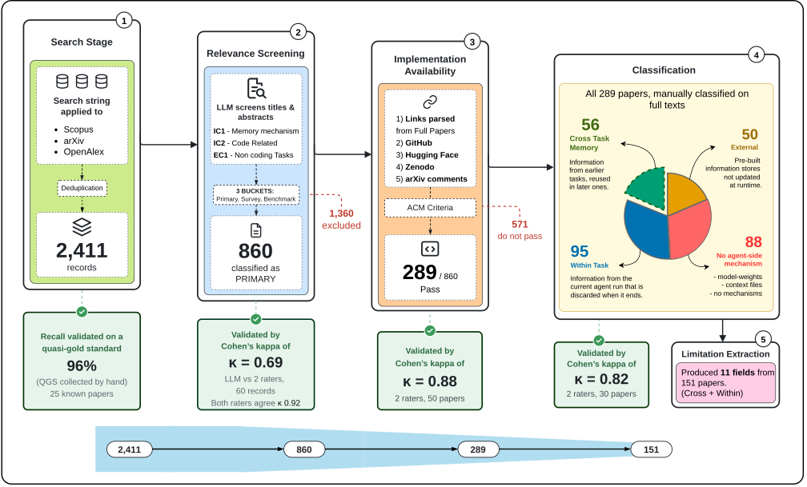
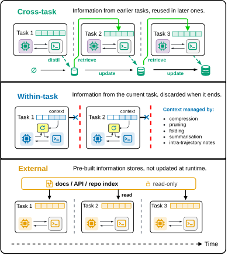
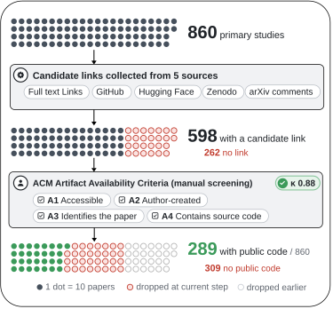

<div align="center">

# Memory or Context?
### A Rapid Review of Information Management in Coding Agents

**Replication package**

[Pranav Swarup Kumar](https://scholar.google.com/citations?user=L7XN5AsAAAAJ&hl=en) · [Karthik Vaidhyanathan](https://scholar.google.com/citations?hl=en&user=qtITyHkAAAAJ)

Software Engineering Research Centre (SERC), IIIT Hyderabad, India

<!-- Badges: add once available
[](https://arxiv.org/abs/XXXX.XXXXX)
[](https://doi.org/10.5281/zenodo.XXXXXXX)
[](#)
-->
[](#license)
[](#license)

</div>

---

This repository contains every input, output, label, guideline and script used in the paper. Each stage of the study has its own folder, numbered in the order the stages were run, so that any count in the paper can be traced back to the file it came from.

<p align="center">
  
</p>
<p align="center"><em>Overview of the study. Each stage reports the number of papers it retains and the validation applied to it.</em></p>

## Abstract

LLM-based coding agents increasingly include components that their authors call memory. The name covers mechanisms that draw on different sources of information: the current task, earlier tasks, or persistent resources such as documentation and repository indexes. Only mechanisms that draw on earlier tasks let an agent carry experience from one task to the next, and they must be designed and evaluated differently from the rest. We report a systematic mapping study of memory and information-handling mechanisms in LLM-based coding agents. From 2,411 records retrieved from Scopus, arXiv and OpenAlex, LLM-assisted screening validated against two human raters retained 860 primary studies. Most of this literature is unrefereed, so we used the availability of a public implementation, not the publication venue, as the criterion for the evidence we analyse: 289 of the 860 papers meet our adaptation of the ACM Artifacts Available criteria. We classified these 289 papers by hand according to the source of the information their mechanism supplies. Of them, 201 have an information-handling mechanism: 95 work within a single task, 50 draw on persistent external sources, and 56 carry information across tasks. A further 54 improve the agent by changing model weights.

## Research Questions

| | Question |
|---|---|
| **RQ1** | What is the landscape of memory and information-handling mechanisms in LLM-based coding agents, and how much of it can be inspected through an available implementation? |
| **RQ2** | What types of memory mechanisms are implemented in coding agents, by the source of the information they supply? |
| **RQ3** | What limitations and challenges do the authors of these mechanisms report, and how do they evaluate them? |

## Information Sources

The classification adapts the three memory sources of Zhang et al. (*A Survey on the Memory Mechanism of Large Language Model-Based Agents*, ACM TOIS 2025) from trials to tasks.

| Source | The mechanism supplies information that is... | Example |
|---|---|---|
| **Within-task** | produced during the current task and not available to any later task | SWE-Pruner |
| **Cross-task** | produced by executing earlier, separate tasks (by the same agent, other agents or human developers) | SWE-Exp |
| **External** | persistent and produced by no task, such as documentation, web search or a code index not updated from task outcomes | Prometheus |

<p align="center">
  
</p>
<p align="center"><em>Cross-task, within-task and external information management in coding agents.</em></p>

Papers with no agent-side mechanism are recorded with one of three reasons: the agent learns in model weights, there is no identifiable information-handling mechanism, or the paper studies human-written context files. The full decision rules are in [`4_classification/guidelines.md`](4_classification/guidelines.md).

## Results at a Glance

<p align="center">
  
</p>
<p align="center"><em>Implementation screening: candidate links from five sources, inspected against the four availability criteria.</em></p>

| Stage | Result |
|---|---|
| Search | 2,411 unique records from Scopus, arXiv and OpenAlex |
| Relevance screening | 1,048 relevant: 860 primary studies, 104 surveys, 84 benchmarks |
| Implementation screening | 598 papers with a candidate link; **289** with an available implementation |
| Classification | 95 within-task · 50 external · **56 cross-task** · 88 no agent-side mechanism |

## Methodology

The study follows the guidelines for systematic mapping studies of Petersen et al. (IST 2015) under rapid-review constraints, and is reported according to SEGRESS.

1. **Search.** A four-block string (model ∧ agent ∧ memory ∧ code), fixed on 2 August 2026, was run on Scopus directly and on arXiv and OpenAlex through their APIs. Recall was checked against a quasi-gold standard of 25 papers: 24 were found.
2. **Relevance screening.** An LLM (qwen3.5:397b, temperature 0) screened titles and abstracts against the inclusion and exclusion criteria and returned an inclusion probability, a bucket and a reason. Records scoring at least 0.70 were retained.
3. **Implementation screening.** Candidate links were collected from the full text, the arXiv comment field, Zenodo, Hugging Face and a GitHub search. Every paper with a link was then judged by hand against four criteria adapted from the ACM *Artifacts Available* badge: accessible, author-created, relevant to the paper, and containing source code.
4. **Classification.** Each of the 289 papers was classified by hand from its full text by information source, role (core or component) and software engineering activity, with a verbatim quote and a rationale per paper.
5. **RQ3.** Within-task and cross-task papers were coded for reported limitations by thematic synthesis, and their evaluations were extracted with a structured form.

### Validation

| Stage | Sample | Agreement |
|---|---|---|
| Relevance screening | 60 records, stratified by score band | Rater vs rater κ = 0.92; LLM vs consensus κ = 0.69; estimated recall 91.4% |
| Implementation screening | 50 papers, random | κ = 0.88 (47 of 50) |
| Classification | 30 papers, random | κ = 0.82 (26 of 30) |
| RQ3 limitations coding | 20 papers | *to be added* |

## Repository Structure

```
replication/
├── FREEZE.md                           Record of the frozen protocol versions
├── figures/                            Figures used in this README (SVG)
├── corpus/
│   └── corpus.csv                      The 2,411 deduplicated records
├── quasi_gold_standard_test_qgs/
│   ├── definitions.md                  How the QGS was assembled
│   └── qgs.csv                         QGS papers and whether the search found them
├── 1_search_string_and_corpus/
│   ├── search_protocol.md              Sources, blocks, dates and revision history
│   └── search_string.txt               The exact search string
├── 2_relevance_check_and_bucketing/
│   ├── relevance.md                    Screening criteria and cutoff
│   ├── screened_qwen3.5_397b_r1.jsonl  LLM output for every screened record
│   └── cohens_kappa/                   Validation sample, both raters' labels, disagreements
├── 3_implementation_screening/
│   ├── 598_papers_to_be_reviewed.xlsx  Papers with at least one candidate link
│   ├── PSK_rated_implementations.xlsx  First rater
│   ├── AG_rated_implementations.xlsx   Second rater (random sample)
│   ├── rated_implementations_discrepancies.xlsx
│   ├── rated_implementations_final_598.xlsx
│   └── outcome_screening.md
├── 4_classification/
│   ├── classification_joined.xlsx      ★ Final classification of all 289 papers
│   ├── guidelines.md                   Classification guideline
│   ├── rationale.md                    Per-paper rationales
│   ├── classification_report.md
│   ├── manifest.csv
│   ├── notes.txt
│   ├── cohens_kappa/                   30-paper sample, both raters' labels, mismatches
│   └── results/                        One JSON per classified paper
├── 5_rq3_form/
│   ├── README.md                       Details of the RQ3 extraction
│   ├── report.md
│   └── results/                        Extracted fields, LLM outputs, agreement, human evaluation
└── scripts/
    ├── stage1/                         Harvesting (arXiv, OpenAlex) and deduplication
    ├── stage2/                         LLM screening and kappa sample
    ├── stage3/                         Implementation-screening sample and rating tool
    ├── stage4/                         Joining classification results and rating tool
    └── stage4_rq3_form/                RQ3 extraction form, prompt and pipeline
```

### Main artifact

[`4_classification/classification_joined.xlsx`](4_classification/classification_joined.xlsx) holds the classification of all 289 papers with an available implementation: information source, role, software engineering activity, the verbatim quote that supports each decision, and the rationale. It is the file to start from if you want to reuse or extend the mapping.

## Reproducing the Study

The scripts are written in Python and should be run in the order of the stage folders.

| Step | Scripts | Output |
|---|---|---|
| Harvest and deduplicate | `scripts/stage1/` | `corpus/corpus.csv` |
| Relevance screening | `scripts/stage2/screen.py` | `2_relevance_check_and_bucketing/screened_*.jsonl` |
| Screening validation | `scripts/stage2/cohens_kappa/` | `2_relevance_check_and_bucketing/cohens_kappa/` |
| Implementation validation | `scripts/stage3/` | `3_implementation_screening/` |
| Classification | `scripts/stage4/` | `4_classification/` |
| RQ3 extraction | `scripts/stage4_rq3_form/rq3_01` to `rq3_05` | `5_rq3_form/results/` |

**Requirements.** TODO: Python version and `requirements.txt`.

LLM screening and extraction call hosted models and need an API key for the provider. LLM outputs can vary between runs even at temperature 0, so the outputs used in the paper are included and all later stages can be rerun from them.

## Citation

If you use this package, please cite:

```bibtex
@misc{kumar2026memorycontext,
  title  = {Memory or Context? A Systematic Mapping Study of Memory and
            Information-Handling Mechanisms in LLM-Based Coding Agents},
  author = {Kumar, Pranav Swarup and Vaidhyanathan, Karthik},
  year   = {2026},
  note   = {Under review}
}
```

## License

- **Code** (`scripts/`): MIT License.
- **Data, labels, guidelines and reports**: [CC BY 4.0](https://creativecommons.org/licenses/by/4.0/).
- Bibliographic metadata retrieved from Scopus, arXiv and OpenAlex remains subject to the terms of those sources.

## Acknowledgment

We sincerely thank Aviral Gupta for independently labelling the validation samples.

## Contact

Pranav Swarup Kumar, pranavswarup.kumar@research.iiit.ac.in